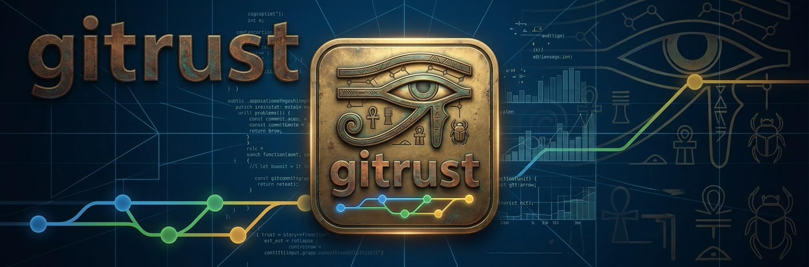
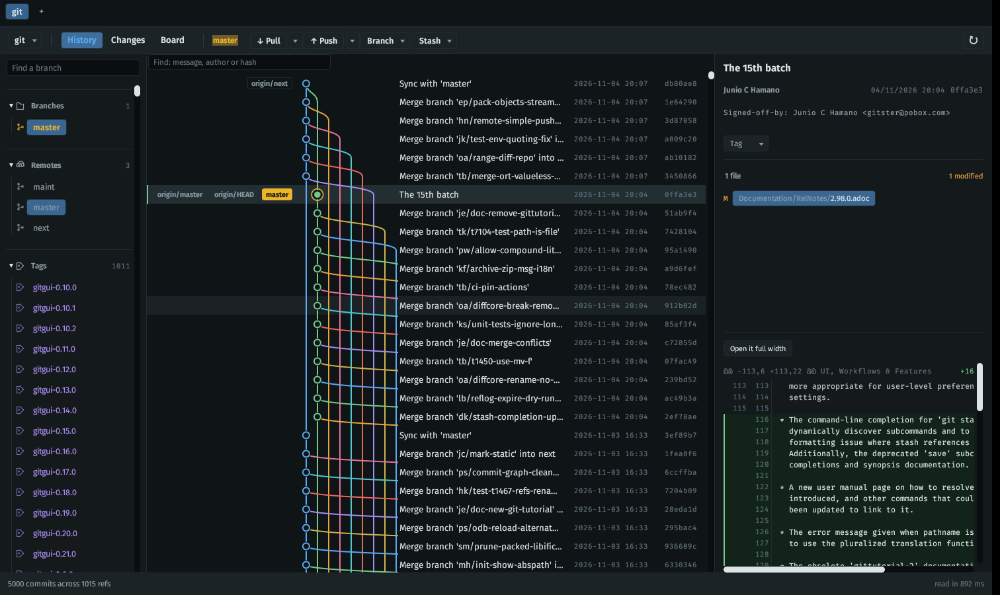
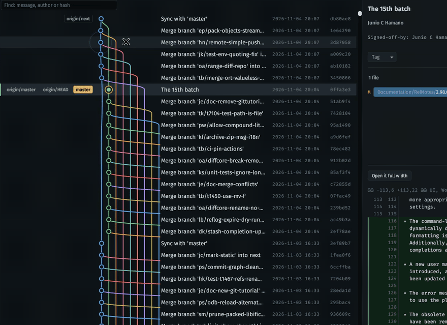
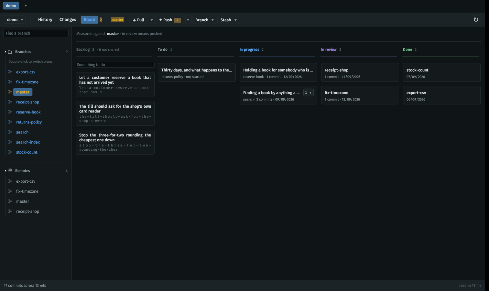
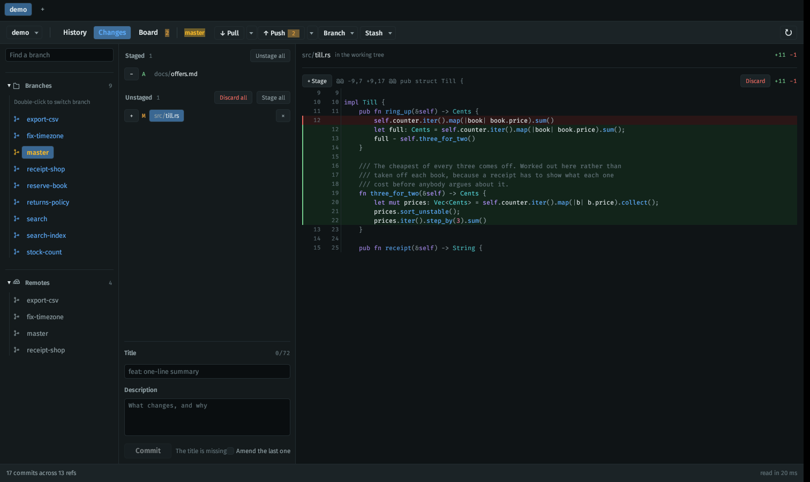
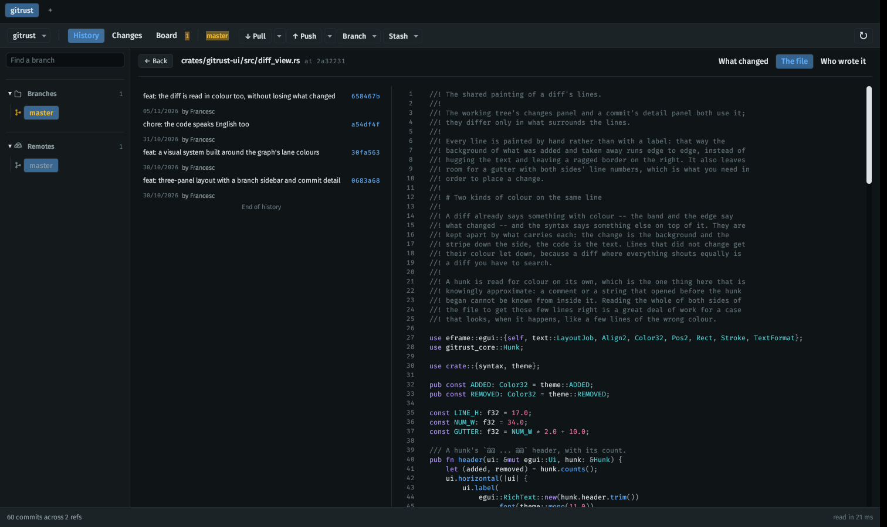
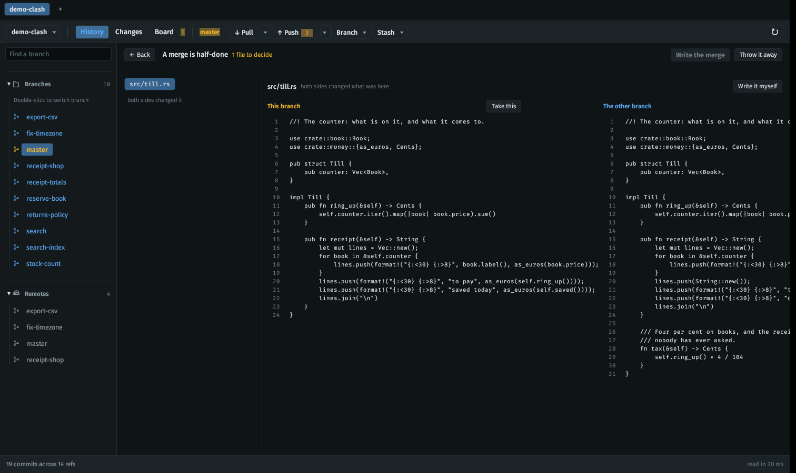

# gitrust

> **Trust, protected. Code, eternal.**

[](https://github.com/FrancescBagur/gitrust/actions/workflows/ci.yml)
[](LICENSE)

> ### Your project board is already in your repository. gitrust just draws it.

### [Download it](https://github.com/FrancescBagur/gitrust/releases/latest)

A `.deb`, a Linux tarball, a Mac app and a Windows zip, built by the machine
that runs the tests. [Which file, and what each one will
warn you about.](#installing)

A desktop Git client in Rust. The aim is to cover the day-to-day flow without
depending on a commercial licence, starting with what is hardest to find free
and well made: **the commit graph with every branch woven through it** -- and
a board above it that is worked out from the branches rather than kept
anywhere, so it travels with the repository and asks for no account, no
server and nothing to sign up for.

**Linux, for now.** It is built on macOS and on Windows by CI and has never
been *run* on either, and there is no package for them yet. On Linux it is
[three commands](#building), or one if you want it on the desktop with its
icon.

**It is written with Claude Code, deliberately and in the open.** The commit
log is in prose, the comments say what the code gets wrong and cannot know,
and [docs/assistant.md](docs/assistant.md) is the thinking about whether the
assistant belongs *inside* gitrust as well. Read any of the three and judge
for yourself; nothing about how this was made is hidden.



That is git's own history: five thousand commits across a thousand and
fifteen references, drawn in nine hundred milliseconds.

**The lanes answer the pointer.** A lane is a line held at both ends, and a
line held at both ends is a string: touch a row and the lane it is on bends
away from the touch and comes back, while rings go out from the commit under
it. Two touches a few rows apart leave a lane carrying both, because a string
does not forget the first one when it gets a second.



**Waves**, at the right-hand end of the bar beside Reload, turns it off --
and off it the graph is drawn exactly the way it was before there was one:
straight lanes, a flat band under the row, and not a frame asked for while
nobody moves.

## What it looks like

**The board is not stored anywhere.** The columns are worked out from the
branches, a branch cut from another branch is a subtask of it with the count
on the card, *in review* means a pull request is open, and the only thing
written down is the work nobody has begun yet -- which lives in a Git
reference and travels with the repository.



**What is uncommitted, the diff and the commit box on one screen**, so that
staging a piece of a file and writing the message about it are not two
places you go.



**One file across the window**: everything that ever happened to it down the
left, and on the right what this commit did to it, the whole of it as it
stood, or who wrote each line.



**A clash is decided file by file**: this branch on one side, the other one
on the other, take either or write the answer yourself. A merge, a rebase, a
cherry-pick and an undo all stop here instead of being thrown away.



## State

- [x] Open a repository and walk every reference
- [x] Graph layout in lanes, with merges and a color per branch
- [x] Virtualised painting (only the visible rows)
- [x] A change list split between index and working tree
- [x] Per-file diff, stage and unstage, and commit with subject and description
- [x] Stage and unstage a single hunk
- [x] Discard changes: by file, by hunk or all of them, with a warning
- [x] Three panels: branches, graph and commit detail
- [x] A theme of its own: one single saturated family, the lanes'
- [x] The uncommitted changes, as one more row above the graph
- [x] An action bar: pull, push, new branch and stash
- [x] Force push with lease, and sending tags
- [x] Pull four ways: fetch, merge, fast-forward only and rebase
- [x] A column of branches and tags to the left of the graph
- [x] Search the history by message, author or hash
- [x] A board of columns, worked out from the graph and storing nothing
- [x] In review means a pull request is open, asked of the forge through
      `gh`, or of GitLab through `glab`
- [x] A branch cut from a branch is a subtask: go into a card and there it is
- [x] Dragging a card runs the operation that would have moved it
- [x] A backlog everyone with the repository shares, kept in a reference
- [x] A branch can say what it is for, in words, and the card shows them
- [x] Everything in English, interface and code alike
- [x] Switch branch, including to one that only exists on the remote
- [x] Delete branches, here or on the remote, saying what is lost
- [x] Merge a branch into the current one, or replay it on top with a rebase
- [x] Amend the last commit, with a warning if it already went to the remote
- [x] Tags: make them lightweight or annotated, and delete them
- [x] Open a branch in a folder of its own, and jump between the folders
- [x] Right-click a branch for everything that can be done to it or from it
- [x] Take a commit along, take one back, and move a branch to one
- [x] Decide a clash file by file: take a side, or write it yourself
- [x] A merge, a rebase, a cherry-pick and an undo all stop where they clash
- [x] Carry a rebase on commit by commit, or throw the whole thing away
- [x] One file across the window: its whole history beside the commit you
      pick, as a diff, as the file itself, or blamed line by line
- [x] Syntax colour everywhere code is shown, out of the graph's own palette
- [x] Undo one hunk of an old commit, into the working tree
- [x] Rewrite a run of commits: squash, fixup, reword, drop, reorder
- [x] An icon, a name on the dock, and one command that installs it
- [x] A profile per client: the name on the commits, the SSH key, and the
      GitHub and GitLab accounts, switched from the tab strip
- [ ] Three-way editor with line-by-line picking
- [ ] Submodules, bisect, LFS, signing

## Architecture

```
crates/
  gitrust-core/     Git logic, with no UI dependencies
    repo.rs         repository, commits, index and diffs (libgit2)
    branch.rs       making branches, switching between them and deleting them
    merge.rs        joining two branches or rebasing one, and stopping where it clashes
    conflict.rs     getting out of a merge or rebase that clashed
    tag.rs          lightweight and annotated tags
    remote.rs       fetching, pushing, and the distance to the remote branch
    stash.rs        the pile of changes set aside
    graph.rs        the lane algorithm, and the uncommitted-changes row
    history.rs      taking a commit along, taking one back, moving a branch
    rewrite.rs      a plan for a run of commits, carried out in memory
    board.rs        which column each branch falls in, and what came from what
    backlog.rs      the work with no branch yet, and how it travels
    note.rs         what a branch is for, in the words somebody used
    worktree.rs     the same repository checked out in several places
    start.rs        cloning one down, or starting an empty one
    known.rs        the repositories this machine has opened
    profile.rs      who you are working as: the name, the key, the accounts
    forge.rs        the pull requests, which Git does not store
    status.rs       the working tree's state
    diff.rs         a diff cut into hunks
    file.rs         one file: at a commit, blamed, its history, a hunk undone
    detail.rs       a commit's detail, and the references
    message.rs      putting the commit message together
    model.rs        the shared types, and which reference rules a commit
  gitrust-ui/       the egui application
    main.rs         window, state and carrying actions out
    theme.rs        color, typography and spacing
    syntax.rs       code cut into coloured pieces, with no crate to do it
    action_bar.rs   pull, push, branch and stash
    refs_view.rs    the sidebar of branches, tags and checkouts
    picker.rs       choosing a repository, cloning one, starting one
    profiles_view.rs the profiles, and which one is in use
    chooser.rs      asking the desktop for its own folder dialog
    graph_view.rs   painting the graph and the references column
    board_view.rs   the branches laid out in columns
    detail_view.rs  the commit detail panel
    file_view.rs    one file across the window: its history, and three readings
    rewrite_view.rs one row per commit, and what is to become of it
    conflict_view.rs the two answers side by side, and the ways out
    changes_view.rs the change lists, the diff and the commit box
    diff_view.rs    the shared painting of diff lines
assets/             the art, and everything cut out of it
  source/           the three pictures as they were drawn
  screens/          what it looks like running, and waves.gif of it in use
  make.py           how the cut-outs were made, so they can be made again
packaging/          the desktop entry, and the scripts that put it in place
tools/              poke.c, which clicks, so that what answers a click
                    can be run instead of only read
```

The views do not touch the repository: they give back an `Action` and `main.rs`
carries it out. That keeps the painting free of side effects.

The core knows nothing of the UI. If egui ever stops fitting, `gitrust-ui` is
replaced and the Git logic is left intact.

What takes time leaves for a thread of its own, which opens its own repository
and sends back one answer over a channel: fetching and pushing, because the
network takes as long as it takes, and laying the board out, because weighing
thirty branches against each other is well over a second. The board already on
screen stays up until the new one arrives. The painting thread waits for
nobody.

**Rewriting history is all of it or none of it.** Everything else here that
writes stops where it clashes and waits to be decided. Rewriting a run of
commits does not, and the reason is worth knowing before you press it. A
merge is one clash. A rebase is one clash per commit, and libgit2 keeps that
sequence in `.git`, which is what lets the application put it down and pick it
up — and what lets `git status` explain the repository if you look at it with
anything else. A plan with squashing and reordering in it is not something
libgit2 has at all. Stopping halfway through one would mean inventing a
sequencer and writing it somewhere in `.git` that no other tool understands,
and then a repository caught in the middle would be one nothing could account
for. So the whole plan is worked out in memory, and the branch moves in one
step at the end. If anything clashes, nothing has been written and the plan
comes back with the commit that would not go.

**Syntax colour without a syntax crate.** Code is read by something that
knows five or six shapes — a comment, something in quotes, a number, a word
the language owns, a word starting with a capital, a word with a bracket
after it — which turns out to be very nearly all the colour anybody reads.
The alternative was a grammar for two hundred languages and a parse tree, to
make `import` purple. It gets things wrong and says which: a language whose
comments are neither `//` nor `#`, and anything clever with quotes. One thing
it does not get wrong is the text, and that is tested — whatever goes in
comes back out character for character, because a piece dropped on the way
is a character missing from the file on screen. The colours are the lanes':
violet for the words the language owns, turquoise for the names you gave
things, azure for what you call, brass for quotes, rose for numbers, grey for
what is said to a human. The rule is that colour comes from the graph's
family or it does not come, and a code view is exactly where a rule like that
gets broken by somebody reaching for a generic editor palette.

A diff carries both kinds of colour at once, and they are kept apart by what
carries each: the change is the background band and the stripe down the side,
the code is the text. Lines that did not change get their colour let down,
because a diff where everything shouts equally is a diff you have to search.
A hunk is read on its own, so a comment or a string that opened before the
hunk began cannot be known from inside it — reading both whole sides of the
file to get those few lines right is a great deal of work for something that
looks, when it happens, like a few lines of the wrong colour.

**Git backend:** `git2` (libgit2) for the bulk of the operations. For
credential helpers, LFS and hooks the plan is to delegate to the real `git`
binary, as the commercial clients do, because libgit2 does not cover them well.

**The backlog:** the one column that is stored, because work nobody has begun
leaves no trace in a repository. It is kept in `refs/gitrust/backlog`, a
reference outside the branch namespace — the same trick `git notes` plays with
`refs/notes/*` — so it is invisible to the graph, to the labels on the commits
and to the sidebar without any of them knowing it exists, and it reaches
everybody who has the repository by being pushed and fetched by name. One file
per item, so two people writing down two different things merge without
noticing. What keeps it from rotting is a rule rather than a mechanism: an item
lives there only until it becomes a branch, and from that moment it is read off
the graph like everything else.

**What a branch is for:** a branch name is what is left of a sentence after
it has been filed down to fit a reference, and until now it was all the
written intention a repository held — starting a backlog item turned the
sentence you wrote into a slug and lost it. A note gives it back: a line in
your own words, and a paragraph under it if there is more to say. It lives in
the backlog's own reference, under `notes/` beside its `items/`, because
starting an item has to take it out of the waiting room *and* write its note,
and across two references that is two commits with a half-done state between
them. One file per branch, named after the branch with its slashes turned
into `~`, which Git will not have in a reference name and so cannot be
confused for one. A note is not tidied away when its branch goes: a branch
can come back and a deletion can be a mistake, and that is worth more than
the clutter.

**Subtasks:** a branch cut from another branch is a piece of that branch's
work. Nothing records that either, so it is read off the graph: a branch is a
child of whichever other branch it shares more history with than it shares
with the trunk. The board inside a card is then the same board measured
against a different branch, and "done" for a subtask is having gone into its
parent. It is a reading and not a fact: once a branch keeps committing after
something was cut from it, the two are the same shape, and the names are what
decide — `report` under `report-export`, the same convention that already
groups the cards. Where it is wrong it is wrong out loud, with a test pinning
each case. A card carries the count of what came out of it, and that badge is
the way in.

**Worktrees:** one repository can be checked out in several folders at once,
each with its own branch, sharing one history. A card says which folder its
branch is open in and takes you there; right-clicking one that is open
nowhere offers it a folder of its own. A branch can only be open in one
place, so switching to one that is open elsewhere says where it is rather
than refusing, and the checkout you are looking at is not one you can close.
The folders go beside the repository, never inside it.

**The forge:** Git stores nothing about pull requests, so a branch that is
merely pushed and one somebody is reviewing look alike from inside the
repository. The board asks the forge's own tool instead of guessing -- `gh`
for GitHub, `glab` for GitLab -- on its own thread, the first time it is
opened. Which of the two, and as whom, comes from the profile in use: the
account whose host matches the remote's decides it. Without the tool, without
a login, or on a remote that is on neither forge, nothing breaks: the board
goes back to reading the graph alone and the header says so, because a column
that is guessing should admit it.

**Profiles:** one machine is often several people -- an employee in the
morning, a contractor in the afternoon, two hosts, two keys, two accounts.
The usual way of living with that is a pile of `includeIf` blocks in
`.gitconfig` and an `~/.ssh/config` nobody dares touch. A profile is that
pile named: a name for the commits, a private key for the remote, and an
account per forge, switched from the end of the tab strip. Every part of it
is optional, and an empty part means the answer that was there before --
Git's own settings, the SSH agent, whatever `gh` is logged in as -- so a
profile can exist for its key alone. A profile with no key yet can be given
one -- ed25519, no passphrase, named after the profile, beside your other
keys -- and hand you its public half for the box on the forge's settings
page; it will not write over a key that is already there, because the other
half of that one is sitting on somebody's server. A second person at the
same client is the first one duplicated and renamed. It writes nothing into
`.gitconfig` or `~/.ssh/config`: a program that rewrites the files other
programs read is a program that breaks them while you are not looking. **The tokens are on the
disk in plain text**, in a file written `rw-------`, which is the same
bargain `~/.netrc` and `gh`'s own `hosts.yml` make; whoever is not content
with it leaves the token empty and lets the forge's tool answer as itself.

**The folder dialog:** the one dependency that was not part of the plan.
Opening a repository meant typing its path, and the obvious fix was to run
`gdbus` and ask `xdg-desktop-portal`, the way `gh` is run to ask GitHub. It
does not work, and the reason is not a bug anybody can fix: the portal's
reply is a directed signal addressed to whoever asked, `gdbus call` exits the
moment it has a handle, and `gdbus monitor` never sees it -- measured, with a
process that stayed alive getting the reply at the same moment the monitor
printed nothing. The caller has to stay on the bus, which means a D-Bus
client in-process. So `rfd`, which costs three crates rather than the tree
that number usually implies: the D-Bus machinery is already in this binary,
pulled in by eframe for Wayland. A folder dragged onto the window still
works everywhere, and still costs nothing.

**An assistant:** not built, and perhaps never. The thinking that was done
about putting Claude Code inside gitrust is written down in
[docs/assistant.md](docs/assistant.md) rather than lost: what gitrust knows
that a terminal does not, the fact that a task here holds no text at all
today, and why the part worth building first has no assistant in it.

## Building

System dependencies on Debian/Ubuntu/Pop!_OS:

```bash
sudo apt install -y rustc cargo cmake libssl-dev libxkbcommon-dev \
  libwayland-dev libx11-dev libxcursor-dev libxi-dev libxrandr-dev \
  libgl1-mesa-dev
```

Optional, for the board's pull requests:

```bash
sudo apt install -y gh && gh auth login
```

And for a repository on GitLab, `glab` in the same place:

```bash
sudo apt install -y glab && glab auth login
```

Then:

```bash
cargo run --release -- /path/to/a/repository
```

With no argument it opens the repository in the current directory.

## Installing

Everything is on [the latest
release](https://github.com/FrancescBagur/gitrust/releases/latest), built by
the machine that runs the tests, from the tag and nothing else. Take one:

| | |
|---|---|
| Debian, Ubuntu, Pop!_OS | the `.deb`. Double-click it, or `sudo apt install ./gitrust_*.deb` |
| Any other Linux | the `.tar.gz`, then `packaging/install.sh --no-build` from inside it |
| macOS, Apple or Intel | the `.zip`: drag `Gitrust.app` to Applications |
| Windows | the `.zip`: there is no installer, the `.exe` runs from wherever you put it |

Whichever you took, `gitrust --version` says which one it is.

**None of it is signed.** There is no paid certificate behind these files,
so macOS will say the developer cannot be verified -- right-click, Open,
Open again, once -- and Windows may put a blue sheet in front of it. The
`SHA256SUMS` beside them says what you downloaded is what was built; it says
nothing about who built it, which is what signing is for and what there is
none of yet. Saying so here costs nothing and leaving it to be discovered
costs more than it saves.

To build it yourself and have it on the desktop like any other program --
on the path, in the launcher, with its icon:

```bash
./packaging/install.sh
```

That builds it and writes into `~/.local`: the binary in `bin`, the icon at
every size under `share/icons/hicolor`, and `gitrust.desktop` in
`share/applications`. Nothing is written outside that folder and nothing
needs root. `PREFIX=/usr/local sudo -E ./packaging/install.sh` installs it
for everybody instead, and `packaging/uninstall.sh` takes out exactly what
went in, by name. The entry also joins the list of programs a folder can be
opened with; it never becomes the one that opens them.

**The icon had to be cut out of a picture of transparency.** The art came
as three flat images with a checkerboard painted into them -- the pattern a
tool draws to *say* "nothing here", arriving as pixels like any other. So
the transparency is cut rather than read, and `assets/make.py` is where that
cutting is written down instead of being something somebody once did in an
editor and cannot repeat. The two pictures are cut in two different ways,
because they are nothing alike: the plaque's outline is a shape, so it is
cut as a rounded rectangle measured off the pixels, which leaves an edge
with none of the JPEG's fringe on it; the mark is an eye and a word and a
line of dots, which is not a shape at all, so it is cut by colour -- the
checkerboard is grey to the byte and no part of the drawing is. What that
second one gets wrong is worth knowing: it was drawn on a dark background,
so on a white page a faint grey hem is left around the softest edges.

## Tests

```bash
cargo test
```

The graph algorithm is the piece most at risk of regression, and the operations
that write — index, stash, branches and remote — are the ones that touch your
files. Those are the ones that carry cover: two hundred and ninety-one
tests, two hundred and seven of them against real repositories made in
`/tmp` and
deleted when they finish.

The remote ones talk to a bare repository in another temporary directory. Over
a disk path they walk the same road as a real remote — the refspecs, the fast
forward, the branch that starts tracking another — without depending on there
being a network or credentials.

## Contributing

[CONTRIBUTING.md](CONTRIBUTING.md) has the long version. The short one: the
most useful thing anybody can do right now is **run it on a Mac or on
Windows**, because it is built on both and has never been opened on either.
After that, the three-way conflict editor and the four holes at the bottom
of the list above.

Commits are signed off with `git commit -s` and the message is a sentence
about what is now true, the way `git log` already reads. There is no CLA and
there will not be one: nothing anybody sends here stops being theirs, and
the consequence is that this cannot later be closed or sold, because a part
of it would not be mine to sell.

## Licence

GPL-3.0-only. The full text is in [LICENSE](LICENSE).

What that comes to in practice: use it for anything, at work or at home, and
pay nothing. Change it and keep the change to yourself, and nothing is owed
either. Hand the changed version to somebody else, as a binary or as a
package, and the source goes with it, under this same licence.

It was the Affero licence for a day, on the argument that `gitrust-core` is a
library with no interface in it and could therefore be put behind a web page
without anything ever being distributed. True, and it protects less than it
sounds: the part that makes this worth copying is about fifteen hundred lines
and the idea behind them is explained at the top of this page, so anybody who
wants that product will write it rather than fork it. What the Affero clause
does reliably is keep the program off machines where somebody's policy bans
those four letters -- and those are working developers, which is who this is
for.

Nobody is forbidden to sell it. Selling it *closed* is what is forbidden,
and the two are not the same: a copy sold under this licence arrives with
the source, and whoever paid for it may give that away to anybody. That is
the whole of the protection, and it is enough.

No dependency forced the choice. libgit2 is GPLv2 with a linking exception
and the Rust crates are `MIT OR Apache-2.0`, so every licence was available:
a tool made to stop paying for a licence should not be something anybody
else can close.
